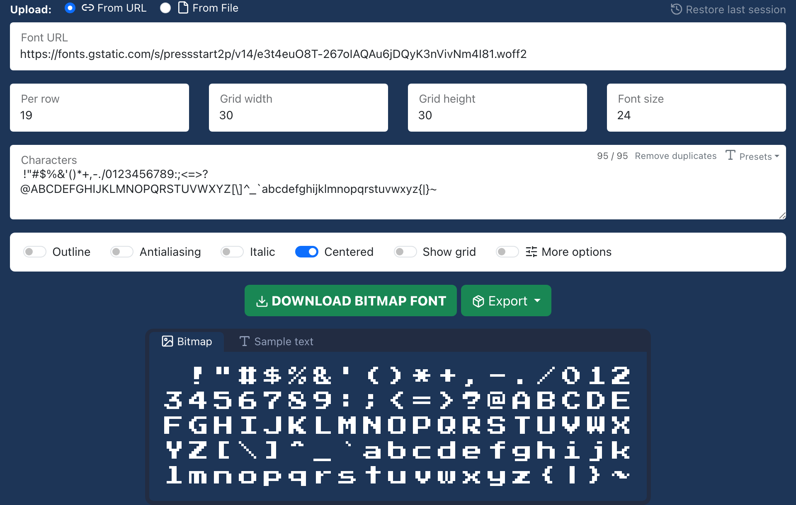

# Font To Bitmap Converter

Turn any font (ttf, otf, woff, woff2) into a **bitmap font** - in the browser, nothing to install.

## Live

- https://stmn.itch.io/font2bitmap
- https://stmn.github.io/font2bitmap

## Loading a font

1. **From file** - pick a font file, or drag and drop it anywhere on the page.
2. **Font URL** - a direct link to the font binary.
Example: https://fonts.gstatic.com/s/pressstart2p/v14/e3t4euO8T-267oIAQAu6jDQyK3nVivNm4I81.woff2
3. **Stylesheet URL** - a css file containing the `@font-face` you want.
Example: https://fonts.googleapis.com/css2?family=Press+Start+2P
4. **Google Fonts autocomplete** - start typing a family name in the URL field.

**Restore last session** brings back your whole setup, including the uploaded font file. Your configuration also lives in the page URL, so you can share a link with the exact settings.

## Exports

**Download bitmap font** saves the PNG atlas. The Export menu adds:

| Export | What you get |
| --- | --- |
| ZIP bundle | PNG atlas + `.fnt` + `.json`, filenames already matching |
| BMFont (.fnt) | Classic AngelCode format, read by most engines |
| BMFont (JSON) | The same metrics as JSON |
| Construct 3 | Spacing data for the Sprite Font object |
| KaPlay | A `loadBitmapFont(...)` snippet for the downloaded atlas |

BMFont metrics (advance widths, kerning pairs, line height, base) are measured from the real font, so the exported file describes the atlas you just downloaded. **Export scale** (1x, 2x, 4x) scales the PNG and the metrics together.

For **Construct 3**: paste the copied JSON into the `Spacing data` property of the Sprite Font, and disable the `Centered` option before downloading the bitmap.

## Shaping the atlas

- Grid width and height, characters per row, font size
- **Character presets**: ASCII, digits, uppercase, plus additive `+ Polish` and `+ Latin-1`
- **All glyphs in font**: fill the set with every character the loaded font actually contains
- **Colors**: text, outline and background, with adjustable outline width
- Italic, antialiasing, centered glyphs, grid overlay
- **Sample text** tab: preview a real sentence before exporting

## Notes

- Disabling antialiasing in browsers is now almost technically impossible. If you need a bitmap without antialiasing, use a non-browser tool - I published one here: https://stmn.itch.io/font2bitmap-standalone
- URLs only work if the server allows cross-origin requests (CORS). Public font providers do.
- Color fonts: `COLR`/`SVG` fonts render in color everywhere, but `CBDT`/`sbix` bitmap color fonts stay monochrome in Firefox, which does not support those tables.

## Technicals

Vite, Bootstrap 5, AlpineJS, fontkit, JSZip, Lucide icons.

- Dev: `npm run dev`
- Build: `npm run build`
- Unit tests: `npm test`
- Browser tests: `npm run test:e2e`
